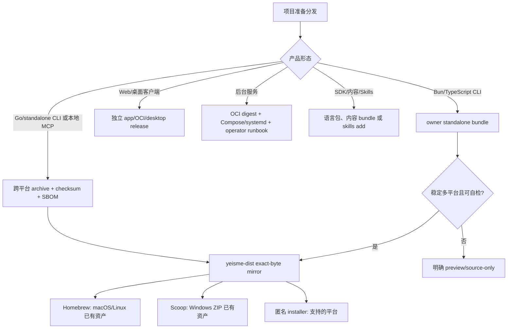

## Context

截至 2026-09-04，公共 `yeisme-dist` 已能匿名镜像并安装 Eikona、Pinax、Auctra、Scaena、gitea-mcp、Sonora、Anatomia 与 credentialctl。Homebrew 使用公共 Cask tap；Scoop 只为具有 Windows ZIP 的产品生成 manifest。当前缺口不是“再写几条安装命令”，而是不同产品形态缺少统一、诚实的渠道准入模型：

- `mcp-gateway` 与 `quaestor` 已有 GoReleaser 和 tag workflow，但尚无可镜像 Release 资产。
- 原执行 owner 子项目（已退役）曾有实验性 Linux x64 standalone bundle，但没有稳定多平台 Release；package 仍为 private。
- `yeisme-workbench` 是 Web + Go service 组合，不应伪装成普通单二进制 CLI。
- API gateway、后台服务、共享库、内容仓和 Skills 有自己的交付渠道，强行加入 Brew/Scoop 会模糊初始化、凭据、数据和运维边界。

利益相关方包括最终用户、产品 owner、`yeisme-dist` 维护者、Skills 维护者与服务 operator。根仓库只拥有组合治理和 handoff；具体 release 代码、manifest 输入、测试与 README 由 owning subproject 维护。

### 必需能力账本

| 能力 | 来源 | 决策 | 状态 |
| --- | --- | --- | --- |
| Linux/macOS 匿名安装器 | 用户明确要求快速安装 | 保留 `yeisme-dist/install.sh`，仅暴露已镜像资产 | 已交付，扩展候选 |
| Homebrew | 用户明确要求 | Go/standalone CLI 资产通过公共 `yeisme/dist` Cask 安装 | 已交付，扩展候选 |
| Scoop | 用户明确要求 | 仅 Windows ZIP 已验证的产品生成 manifest | 已交付，扩展候选 |
| TypeScript/Bun CLI 安装 | 用户要求其它项目尽量补齐 | standalone bundle 为首选；public package registry 为可选渠道 | 待 owner 落地 |
| 后台服务快速部署 | 用户要求其它项目尽量补齐 | OCI image + Compose/systemd/operator runbook，不走通用 CLI Cask | 待各 owner 落地 |
| Skills 快速安装 | 用户明确要求 Skills 支持 | `npx skills add` 或产品 exact-version bundle，和二进制渠道分离 | 已有基础，继续扩展 |
| README 可复制命令 | 用户明确要求 | 只有 `verified` 渠道可以进入默认安装区 | 本 change 冻结门禁 |
| 更新、回滚、卸载 | 正式分发必需 | 渠道级验证和 last-known-good manifest | 待逐产品补齐 |

## Goals / Non-Goals

**Goals:**

- 为每种产品形态选择一个首选安装/部署渠道，并说明其它渠道的进入条件。
- 给所有当前子项目一个 `fit`、`split-owner` 或 `reject-now` 结论，避免“未设计”等于“以后随便打包”。
- 让公共 README 的复制式命令与真实 Release、镜像和平台 smoke 保持一致。
- 保持私有产品源码与公共 exact-byte 分发分离；公共仓不重建产品。
- 为下一批项目提供可直接转成子项目 OpenSpec 的 handoff，不在根级伪造实现完成。

**Non-Goals:**

- 本 change 不创建 tag、GitHub Release、OCI image、npm package、Homebrew Cask 或 Scoop manifest。
- 不建设 apt/dnf/apk 签名仓库，不承诺所有项目支持所有平台。
- 不让安装动作写入凭据、业务数据库、运行证据、远程资源或 provider 状态。
- 不把 SDK、数据仓、Prompt 内容仓、Skills source 或分发基础设施包装成同名终端用户 CLI。
- 不为 local-demo、fixture-only、experimental 或 production gate 未完成的项目写成稳定可用。

## Decisions

### 1. 先按产品形态选渠道，再按项目补实现

选择这一模型，是因为包管理器应表达可交付产品形态，而不是仓库目录。备选方案“所有仓库都生成 Brew/Scoop”会为服务、私有 package 和不完整 sidecar 组合制造误导性入口，因此拒绝。

### 2. 使用统一成熟度状态机控制文档和清单

每个“项目 × 渠道 × 平台”组合只能处于以下状态之一：

1. `not_applicable`：产品形态不适用该渠道。
2. `source_only`：只有源码构建或本地开发入口。
3. `pipeline_ready`：构建/发布配置和本地 snapshot 已验证，但没有正式资产。
4. `assets_available`：不可变正式 tag 已发布 archive、checksum 与所需 metadata。
5. `mirrored`：`yeisme-dist` 已按 upstream digest 复制完整资产。
6. `manifest_ready`：对应 installer/Cask/Scoop/部署 manifest 已从已镜像资产生成并验证。
7. `verified`：干净目标环境完成安装、无副作用版本检查、升级/卸载或回滚 smoke。

状态不得凭 README、tag 名或 CI 配置推断。`pipeline_ready` 不能展示匿名安装命令；`assets_available` 也不能在镜像尚未完成时提前发布指向公共仓的 manifest。预览渠道可展示，但必须标注 `preview`、平台限制和恢复命令，且不能出现在默认稳定安装块。

### 3. 公共分发保持 split-owner

- 产品 owner：构建、测试、签名/校验、命名、版本、自检、SBOM 和 upstream Release。
- `cli/yeisme-dist`：读取 allowlist，镜像 exact bytes，验证完整性，生成公共 Cask/Scoop/installer 索引，执行匿名 smoke。
- 根仓库：能力账本、渠道准入、跨项目排序和 handoff。
- README owner：产品 README 解释产品特定初始化；dist README 解释通用安装；根 README 只提供路由与当前状态。

备选方案“公共 dist 从私有源码重建”会破坏 exact-byte 审计与权限边界；备选方案“每个产品各自维护 Tap/Bucket”会造成 manifest 漂移和重复凭据，因此均拒绝。

### 4. 当前项目组合矩阵

#### 已公开验证与下一步维护

| 项目 | 准入 | 首选渠道 | 当前状态 | 设计说明 |
| --- | --- | --- | --- | --- |
| Eikona | `split-owner` | dist installer + Homebrew + Scoop | `verified` | 保持六平台 archive、Skills exact-version 资产与 setup 分离 |
| Pinax | `split-owner` | dist installer + Homebrew + Scoop | `verified` | 安装不得初始化或修改 Markdown 真源 |
| Auctra | `split-owner` | dist installer + Homebrew + Scoop | `verified` | 安装与 workspace/candidate 状态分离 |
| Scaena | `split-owner` | dist installer + Homebrew | `verified`（Linux x64） | 无 Windows ZIP 时保持 Scoop `not_applicable`；v0.4 多角色另由现有 handoff 管理 |
| gitea-mcp | `split-owner` | dist installer + Homebrew + Scoop | `verified` | 安装不配置 Gitea token 或 Gateway grant |
| Sonora | `split-owner` | dist installer + Homebrew + Scoop | `verified` | provider key 通过显式 auth/credentialctl 流程配置 |
| Anatomia | `split-owner` | dist installer + Homebrew | `verified`（macOS/Linux） | 无 Windows ZIP 时不生成 Scoop；服务 endpoint/access key 后配 |
| credentialctl | `split-owner` | dist installer + Homebrew + Scoop | `verified` | 二进制与 `credentialctl-usage` Skill 分开安装 |

#### 下一批用户工具

| 项目 | 准入 | 推荐首选渠道 | 当前状态 | 进入稳定安装的门槛 | owner handoff |
| --- | --- | --- | --- | --- | --- |
| MCP Gateway | `split-owner` | dist installer + Homebrew + Scoop | `pipeline_ready`；`v0.1.0` 无资产 | 发布新不可变 tag 与跨平台 archive/checksum/SBOM，镜像后做 quickstart-free version smoke | `mcp/gateway/openspec/changes/mcp-gateway-public-install-v1/` |
| Quaestor | `split-owner` | dist installer + Homebrew + Scoop | `pipeline_ready`；无 GitHub Release | 发布首个正式资产版本，验证 archive root binary、version、安装/卸载且不运行 Qlib | `cli/quaestor/openspec/changes/quaestor-public-install-v1/` |
| 已退役执行 owner | `split-owner` | owner standalone bundle；稳定后接 dist | `pipeline_ready`（preview，仅 Linux x64 Actions artifact） | （2026-09-26 整体退役，不再适用；若重新准入需新 change） | 原子项目内 change 随退役移除 |
| Short Drama Radar（已退役） | `reject-now` | 不再创建分发渠道 | 2026-10-01用户撤销，未实现/未发布 | 私有封存与历史合同保留；未来重启需独立准入决定 | 原发布handoff取消，见根Radar退役记录 |

已退役执行 owner 子项目不优先发布 npm package：当时 package 为 private，且产品已有 standalone binary、manifest、checksum 和 installer 合同。该原则泛化为：Bun/TypeScript CLI 先把现有路线扩成稳定 Release 以减少运行时依赖；若未来发布 public package，必须作为独立可验证渠道，不替代 standalone 资产。

#### 客户端、服务与非终端产品

| 项目组 | 项目 | 准入 | 首选交付 | Brew/Scoop 决策 |
| --- | --- | --- | --- | --- |
| （已退役）客户端 | Yeisme Workbench | `reject-now` | 无。2026-10-10 退役 | 不得恢复 launcher、bundle、OCI 或 desktop app |
| API gateway | Aigora | `fit`（部署） | OCI digest + 配置模板 + operator runbook | `reject-now` |
| 后台服务 | Capsa、Runtime Plane、Identity Platform、Template Registry、Harness Control Plane、Firecrawl fork | `fit`（部署） | OCI/Compose/systemd/Kubernetes 由各 owner 选择 | `reject-now`；不得用 Cask 暗中启动服务 |
| 公共 SDK | agent-skills-runtime、promptrepo | `fit`（开发依赖） | Go module release | `reject-now` |
| 内容/数据 | yeisme-notes、prompt-templates | `fit`（内容） | Git/content registry/exact ref | `reject-now` |
| Skills | yeisme-agent-my-skills | `fit`（workflow） | `npx skills add` 与产品 version-bound bundle | `reject-now` |
| 分发基础设施 | yeisme-dist | `fit`（infra） | GitHub repository/workflows | 不自安装为产品 |

后台服务即使有 operator CLI，也不自动成为 Homebrew/Scoop 候选。只有当 owner 抽出一个无常驻副作用、可独立版本化的客户端二进制时，才为该客户端单独准入；服务本体继续走部署渠道。

### 5. README 采用“稳定默认、预览分栏、不可用说明”

稳定安装块必须满足：

- 命令可以匿名执行，使用真实公共仓和真实 package 名。
- 紧随一个无副作用验证命令，例如 `<tool> --version` 或 `<tool> version --json`。
- 不要求用户先创建 shell credential script，也不在命令行参数中放 secret。
- 平台缺少资产时明确写 `Not available`，不得展示会失败的 manifest。

`source_only` 项目可以保留源码构建命令，并写明缺失的 release gate。`preview` 必须与稳定安装分栏，不可使用“推荐”“最新稳定”等措辞。

### 6. 安装验证与证据按 owner 分层

产品 owner 至少验证 archive 解压、root binary、版本一致、checksum、SBOM 和无 secret 输出。dist owner 至少验证匿名下载、digest 一致、Cask/Scoop 生成、干净环境安装、版本检查和卸载。集成证据写入各 owner 的 `temp/integration-test-runs/<run-id>/`，包含标准六件套并脱敏。

安装 smoke 不得执行付费 provider 调用、创建远程资源、启动公网 listener、写入 credential 或初始化业务 workspace。需要初始化的产品只验证 `--help`、`version`、`doctor --offline` 或等价无副作用命令。

### 7. Release 失败与回滚保持不可变

- 已公开的 tag 和 assets 不覆盖；修复使用新版本。
- dist 只在完整镜像成功后推进 `latest`/catalog 和 manifests。
- 新版本 smoke 失败时，公共 manifest 保持上一 `verified` 版本；不删除上一资产。
- uninstall 只移除安装资产，不默认删除用户配置、workspace、数据库或 credential。
- 清理用户状态必须由产品显式命令和单独确认负责。

## Risks / Trade-offs

- [风险] 项目矩阵会随 Release 改变而过期。→ 每个 owner release dispatch 触发 dist 同步；根矩阵记录准入设计，实时版本以 dist catalog 为准。
- [风险] Cask 可运行于 Linux，但不同项目资产平台覆盖不一致。→ 以“项目 × 渠道 × 平台”记录状态，生成器缺资产即 fail-closed。
- [风险] Bun standalone binary 体积较大且跨平台行为不同。→ owner 先做目标平台自检与 smoke；不因追求渠道数量而发布未验证产物。
- [风险] 将服务完全排除于包管理器会降低本机试用便利。→ 提供 Compose/systemd/OCI quickstart；未来可抽出独立 operator client，但不让安装器隐式启动服务。
- [风险] Skills 与产品二进制版本漂移。→ 产品需要 exact-version bundle 时使用共享 Skills registry；通用技能安装明确是独立渠道。
- [风险] 根 change 与子项目实现任务重复。→ 根 tasks 只创建 handoff 与验收条件，具体代码/CI/docs closeout 只存在于 owner OpenSpec。

## Migration Plan

1. 冻结本规格与项目矩阵，不修改现有 8 个已验证产品的命令。
2. 第一波：MCP Gateway、Quaestor。两者已有 release pipeline，先发布新的资产版本并接入 dist。
4. 第三波（已取消）：原执行 owner 子项目（2026-09-26 退役）的实验 Linux bundle 晋级计划随退役终止。
5. 第四波：Short Drama Radar。建立 Bun standalone release 和可选 schedule 安装合同。
6. Workbench 与后台服务分别建立应用/OCI 部署设计；不阻塞 CLI 分发波次。
7. 每个渠道从 `verified` 回退时只撤回/固定 manifest 到上一 verified 版本，不删除已公开资产或用户数据。

## Open Questions

- 已退役执行 owner 的首个稳定范围是否包含 Windows x64：随 2026-09-26 退役不再适用。
- Workbench 首个公开交付形态是 OCI 本机 bundle、托管 Web，还是独立 desktop wrapper；在 production release change 中决策。
- 后台服务是否需要统一的 OCI registry/name/signature policy；若多个服务准备公开部署，应另建根级 service-distribution change。

## Scope 变更日志

| 日期 | 变更 | 原因 | 处置 |
| --- | --- | --- | --- |
| 2026-09-04 | 从“补齐其它项目的 Brew/Scoop”扩展为全项目安装组合 | 仓库同时包含 CLI、Bun 工具、客户端、服务、SDK、内容与 Skills，单一包管理器不适合全部形态 | 保留用户要求的快速安装能力，但按产品形态选择首选渠道 |
| 2026-09-04 | 已退役执行 owner 不改走 npm-first | 已有 standalone bundle 合同且 package 仍为 private | 先推进正式 standalone Release，public package registry 作为独立可选渠道（该子项目已于 2026-09-26 退役） |
| 2026-09-04 | 后台服务和 Workbench 不进入通用 Cask/Scoop | 安装会与常驻服务、数据库、凭据和部署状态混淆 | 分别交给 OCI/service 或 app release 设计 |
